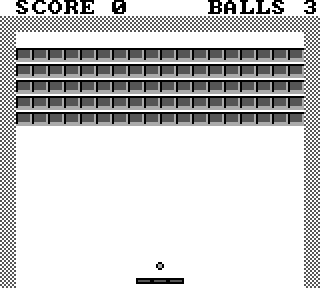
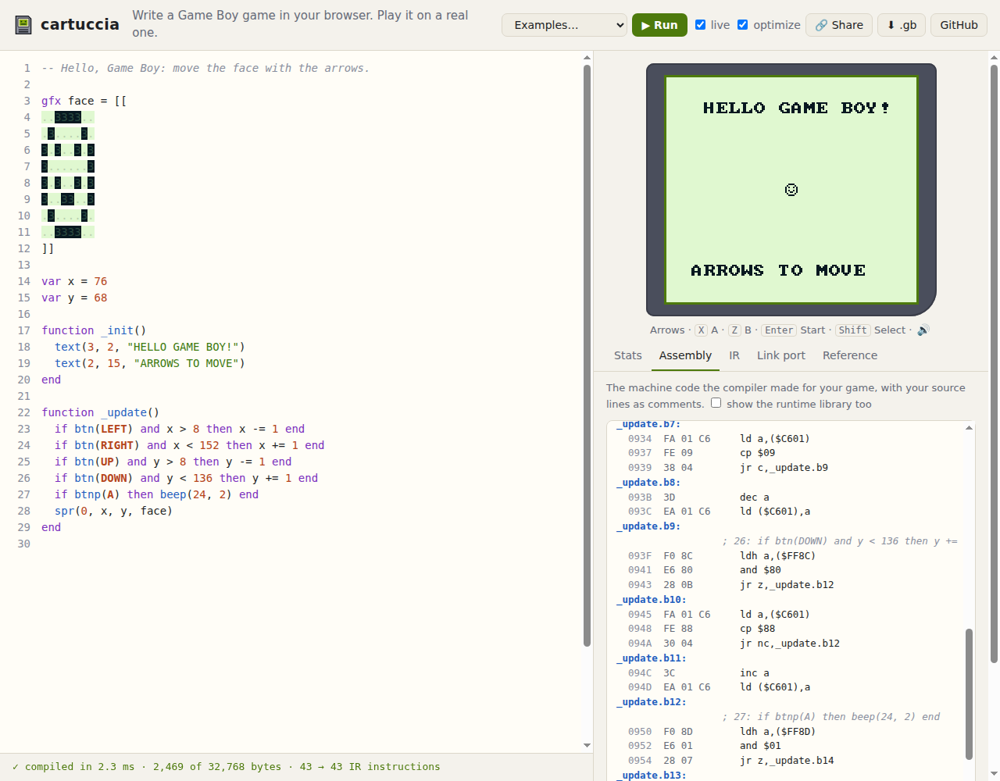

# cartuccia

**Write a Game Boy game in your browser. Download a real cartridge image.**

cartuccia (Italian for *cartridge*) is a small Lua-flavoured language and an optimizing compiler
that turns it into Game Boy ROMs: machine code for the Game Boy's CPU, with the cartridge header
the console checks at boot. It runs entirely in your browser, next to an emulator, and the game
restarts as you type.

### ▶ [Try it: andreaacanfora.github.io/cartuccia](https://andreaacanfora.github.io/cartuccia/)



```lua
-- Hello, Game Boy: move the face with the arrows.

gfx face = [[
..3333..
.3....3.
3.3..3.3
3......3
3.3..3.3
3..33..3
.3....3.
..3333..
]]

var x = 76
var y = 68

function _update()
  if btn(LEFT) and x > 8 then x -= 1 end
  if btn(RIGHT) and x < 152 then x += 1 end
  if btnp(A) then beep(24, 2) end
  spr(0, x, y, face)
end
```

That is the whole program: the pixel art is in the code, there are no type annotations, and
`_update` runs 60 times a second. It compiles to a 32 KB `.gb` file that any Game Boy emulator
opens, and that a flash cartridge carries to a Game Boy.

## What is in it

- **A language you already know.** Lua's syntax (`if … then … end`, `for i = 0, 9 do`, `local`, `--` comments),
  PICO-8's way of making games (`_init`, `_update`, `spr`, `btn`), and pixel art in `[[ ]]` blocks
  drawn with `.` `1` `2` `3`.
- **Types you never write.** Every value is `u8`, `i8`, `u16`, `i16` or `bool`, inferred from how it is used:
  a variable passed to `spr()` as a coordinate becomes `u8`, a score passed to `num()` becomes `u16`.
  When types clash, the error says where each side got its type:

  ```text
  game.cart:5:7: error: `x` and the value assigned to it: one is u8, the other is u16
     5 |   x = score
       |       ^^^^^
  game.cart:1:8: note: `x` is declared u8
     1 | var x: u8 = 1
       |        ^^
  game.cart:4:13: note: num() takes u16 as its value
     4 |   num(0, 0, score)
       |             ^^^^^
  note: convert one of them, like u16(x), or declare it with a type, like `local x: u16`
  ```

  It also catches what is always wrong on an 8-bit machine: `if x < 0` on an unsigned value,
  `300` stored in a `u8`, recursion (there is no room for stack frames, so every variable has a fixed address).
- **A real optimizing compiler**, in about 9,000 lines of Rust (tests included) with no dependencies:
  type inference, a control-flow-graph IR, sparse conditional constant propagation, inlining,
  strength reduction (the SM83 has no multiply: `x * 10` becomes `(x << 3) + (x << 1)`),
  copy propagation, dead code elimination, then SM83 code generation with frames overlaid along
  the call graph, the hottest variables in HRAM, and a register cache that skips redundant loads.
  The playground shows the IR before and after optimization, and the annotated assembly.
- **Tested against a Game Boy.** Thousands of random programs run three ways: an IR interpreter
  before optimization, the same after optimization, and the compiled ROM on
  [mattone](https://github.com/AndreaAcanfora/mattone), a Game Boy emulator that passes the
  mooneye and Blargg test suites. Every number they print must match. The CI does 5,000 programs
  through the optimizer and 400 through the emulator on every push.



## The code it makes

From the program above, `if btn(LEFT) and x > 8 then x -= 1 end` becomes:

```text
  ldh a,($FF8C)     ; the buttons held, kept in HRAM by the runtime
  and $20           ; LEFT
  jr z,next
  ld a,($C600)      ; x
  cp $09            ; x > 8 is x >= 9: no extra instruction
  jr c,next
  dec a             ; x -= 1, still in A
  ld ($C600),a
next:
```

and `spr(0, x, y, face)` loads its arguments straight from the variables:

```text
  ld hl,$C600
  ld b,(hl)         ; x
  ld l,$01          ; HL is already $C6xx: only L changes
  ld c,(hl)         ; y
  ld d,$80          ; the tile of `face`
  xor a             ; sprite 0
  call rt_spr
```

## Using it

**In the browser**: [the playground](https://andreaacanfora.github.io/cartuccia/) has five examples
(Hello, Snake, Breakout, a starfield, a music box), a link-sharing button that puts the whole game
in the URL, and a download button for the `.gb` file.

**On the command line** (Rust 1.88 or newer):

```sh
cargo install --git https://github.com/AndreaAcanfora/cartuccia
cartuccia game.cart              # writes game.gb
cartuccia game.cart --asm        # prints the assembly
cartuccia game.cart --ir         # prints the IR before and after optimization
cartuccia game.cart --stats      # sizes per function
cartuccia game.cart --run        # runs it in the IR interpreter and prints debug() output
```

**On a Game Boy**: copy the `.gb` file to a flash cartridge (EverDrive, EZ-Flash and similar).
The ROM is a plain 32 KB cartridge with no bank controller and a valid header. It is tested on
mattone, not yet on hardware: if you try it on a real console, please open an issue and say how it went.

## The language

The full reference is in [docs/language.md](docs/language.md). In short:

| | |
|---|---|
| frame | `function _init()` once, `function _update()` 60 times a second |
| drawing | `spr(n, x, y, tile)`, `hide(n)`, `tile(col, row, t)`, `gettile(col, row)`, `text(col, row, "HI")`, `num(col, row, n)`, `cls()`, `scroll(x, y)` |
| input | `btn(LEFT)` while held, `btnp(A)` when pressed: `LEFT RIGHT UP DOWN A B START SELECT` |
| sound | `beep(note, length)` (note 0-71 from C3), `noise(length)` |
| other | `rnd(n)`, `frames()`, `vsync()`, `min`, `max`, `abs`, `debug(x)`, `u8(x)` and friends |
| data | `var grid: u8[64]` in RAM, `const levels: u8[] = {1, 2, 3}` in ROM, `gfx name = [[ ... ]]` |

## How it works

The compiler is described in [docs/compiler.md](docs/compiler.md). The pipeline:

```text
source ─ lexer ─ parser ─ type inference ─ IR ─ optimizer ─ SM83 code ─ assembler ─ ROM
                              │                    │
                              └ errors with notes  └ checked against an interpreter
```

| file | what it does |
|---|---|
| [src/check.rs](src/check.rs) | names and type inference (union-find, with the reason for every type) |
| [src/lower.rs](src/lower.rs) | syntax tree to IR: conditions become branches, `and`/`or` short-circuit |
| [src/opt.rs](src/opt.rs) | the optimizer passes |
| [src/codegen.rs](src/codegen.rs) | IR to SM83: memory layout, register cache, instruction selection |
| [src/runtime.rs](src/runtime.rs) | the runtime in every ROM: frame loop, sprites, text, sound, multiply, divide |
| [src/sm83.rs](src/sm83.rs) | the assembler, with `jr`/`jp` relaxation |
| [src/interp.rs](src/interp.rs) | the reference interpreter |
| [tests/fuzz.rs](tests/fuzz.rs) | the differential fuzzer |

## Compared with

- **[GB Studio](https://www.gbstudio.dev/)** makes Game Boy games without code, with a visual
  editor, on the desktop. cartuccia is code-first and runs in the browser.
- **[GBDK-2020](https://github.com/gbdk-2020/gbdk-2020)** compiles C with SDCC and is what you want for a big game.
  cartuccia is far smaller and aimed at the first hour: nothing to install, a game on screen in a minute.
- **[RGBDS](https://rgbds.gbdev.io/)** and [rgbds-live](https://github.com/gbdev/rgbds-live) are assembly.
  cartuccia writes the assembly for you and shows it.

## Limits of version 0.1

32 KB of ROM (no bank switching), 6 KB of RAM for the game, the original Game Boy's four shades
(no Game Boy Color palettes yet), 8x8 sprites, background and sprites but no window layer,
no recursion, and arrays only at the top level. Array indices are not checked at run time.

## License

MIT. The font is Daniel Hepper's [font8x8](https://github.com/dhepper/font8x8), public domain.
